# Perbaikan Bug — Share "view" pada Drive masih bisa menghapus file

| | |
|---|---|
| **Tanggal** | 18 Oktober 2026 |
| **Commit perbaikan** | `9eec9c0` — `fix(drive): share view tidak lagi bisa hapus file` |
| **Modul** | Drive & Dokumen (`drive.php`, `drive_action.php`, `includes/drive_auth.php`) |
| **Status** | Selesai — terverifikasi uji unit fungsi, end-to-end HTTP, dan screenshot UI |
| **Laporan bug** | "Orang yang dibagikan foldernya dapat menghapus file di folder itu padahal sudah dikasih permission hanya view." |

---

## 1. Ringkasan Bug

Folder di Drive dapat dibagikan per-user dengan dua tingkat permission:

- `view (baca)` — penerima hanya boleh **melihat & mengunduh**.
- `edit (kelola)` — penerima boleh upload/rename/hapus/mengatur share.

Bug: penerima dengan permission **view** tetap dapat **menghapus file** di folder
yang dibagikan. Endpoint hapus (`drive_action.php`, action `file_delete`) bisa
dieksekusi walaupun share yang diberikan `view`.

## 2. Dampak

- Share `view` tidak menegakkan prinsip read-only → risiko kehilangan data
  (file yang dihapus juga dihapus fisik dari `uploads/drive/`).
- Owner kehilangan kemampuan membatasi kolaborator pada subtree folder tertentu.
- Inkonsistensi UI: badge share menampilkan `view`, tetapi tombol hapus tetap tersedia.

## 3. Akar Masalah

Ada **dua** jalur yang membuat `canEditDrive()` bernilai `true` untuk penerima view:

### 3.1 Share warisan memakai aturan "hak tertinggi menang"

`getDriveShareForUser()` (kode lama) memilih baris share dari seluruh rantai
ancestor dengan prioritas `edit` di atas `view`:

```php
// includes/drive_auth.php — KODE LAMA (buggy)
"SELECT * FROM drive_shares WHERE folder_id IN (...) AND shared_with_user_id = $1
 ORDER BY CASE permission WHEN 'edit' THEN 0 ELSE 1 END LIMIT 1"
```

Akibatnya, share `edit` pada folder induk **mengalahkan** share `view` yang
diberikan langsung pada folder anak — penerima yang "dikasih view" tetap
dianggap editor.

### 3.2 Admin selalu boleh kelola tanpa melihat share eksplisit

`canEditDrive()` (kode lama) memberikan hak kelola mutlak ke role admin sebelum
memeriksa share:

```php
// includes/drive_auth.php — KODE LAMA (buggy)
if ($role === 'admin') return true;   // ← tidak peduli di-share view
...
$sh = getDriveShareForUser($conn, $folder, $uid);
return $sh !== null && ($sh['permission'] ?? '') === 'edit';
```

Inilah yang terjadi pada data produksi: folder **"SOP"** (owner user #12)
dibagikan `view` kepada **Administrator** (user #1), tetapi Administrator tetap
bisa menghapus file di dalamnya.

### 3.3 Bukti data produksi (`activity_log`)

```text
 id | user_id |        aksi       |                         detail                          |         created_at
----+---------+-------------------+---------------------------------------------------------+----------------------------
 43 |       1 | drive_upload      | 1 file ke folder #5                                     | 2026-10-10 12:06:53
 40 |       1 | drive_file_delete | File #3 "1. PANDUAN MODUL SIMRS Rawat Jalan revisi.pdf" | 2026-10-10 12:06:25
 37 |      12 | drive_share       | Folder #5 -> user #1 (view)                             | 2026-10-10 12:05:55
```

Timeline: user #12 membagikan folder #5 ke user #1 dengan permission **view**
(12:05:55), lalu user #1 berhasil **menghapus file #3** di folder tersebut
(12:06:25).

## 4. Model Hak Akses Setelah Perbaikan

Aturan tunggal: **hak paling spesifik menang**, dan share `view` selalu read-only.

| Kondisi | Hak kelola (edit) |
|---|---|
| Pemilik folder | ✅ selalu |
| Share `edit` terdekat (folder itu sendiri → ancestor) | ✅ |
| Share `view` terdekat (folder itu sendiri → ancestor) | ❌ baca saja |
| Admin **tanpa** share eksplisit | ✅ (superuser default) |
| Admin yang di-share `view` (langsung/warisan) | ❌ baca saja |
| Publik / divisi | ❌ baca saja |

Contoh penerapan:

- Share `edit` di folder induk + share `view` langsung di subfolder →
  subfolder **read-only** (view terdekat menang).
- Share `view` di folder induk, subfolder tanpa share → tetap **read-only**
  (view warisan).
- Share `view` di folder induk + share `edit` langsung di subfolder →
  subfolder **bisa dikelola** (edit terdekat menang).

## 5. Perubahan Kode

File: `includes/drive_auth.php`

```diff
-    // Share langsung ATAU warisan dari ancestor (hak tertinggi menang: edit > view).
+    // Share langsung ATAU warisan dari ancestor. Hak paling spesifik menang:
+    // share pada folder itu sendiri mengalahkan share pada ancestor, sehingga
+    // 'view' langsung bisa membatasi 'edit' yang diwarisi dari folder induk.
...
-            "SELECT * FROM drive_shares WHERE folder_id IN (...)
-             ORDER BY CASE permission WHEN 'edit' THEN 0 ELSE 1 END LIMIT 1",
+            "SELECT * FROM drive_shares WHERE folder_id IN (...)
+             ORDER BY array_position(ARRAY[...]::int[], folder_id) DESC LIMIT 1",
```

```diff
-        $role = $user['role'] ?? null;
-        if ($role === 'admin') return true;
         $uid = (int)($user['id'] ?? 0);
         if ($uid > 0 && $uid === (int)($folder['owner_id'] ?? 0)) return true;
-        $sh = getDriveShareForUser($conn, $folder, $uid);
-        return $sh !== null && ($sh['permission'] ?? '') === 'edit';
+        if ($uid > 0) {
+            $sh = getDriveShareForUser($conn, $folder, $uid);
+            if ($sh !== null) return ($sh['permission'] ?? '') === 'edit';
+        }
+        return ($user['role'] ?? null) === 'admin';
```

Seluruh endpoint (`file_delete`, `folder_delete`, `file_rename`, `file_move`,
`file_upload`, `folder_rename`, `folder_move`, `folder_visibility`, `share_add`,
`share_remove`) sudah memakai `canEditDrive()`, sehingga satu perbaikan ini
menutup semua jalur mutasi. UI (`drive.php`) memakai fungsi yang sama, jadi
tombol hapus/upload/kelola share otomatis hilang untuk penerima `view`.

## 6. Langkah Reproduksi Sebelum Perbaikan (bukti bug)

Skenario: pemilik folder (teknisi) membuat folder, upload file, membagikan ke
Administrator dengan permission **view**, lalu Administrator mencoba menghapus.

1. Login sebagai pemilik (`teknisi1` / `admin123`), buat folder
   **"Demo Bugfix Sharing"**, upload `Contoh-Panduan-SOP.txt`, lalu bagikan ke
   Administrator dengan permission `view (baca)`.

2. Login sebagai Administrator (`admin` / `admin123`), buka folder tersebut.
   **Kode lama:** Administrator tetap melihat tombol hapus (ikon tempat sampah),
   tombol rename, panel upload, dan kontrol share — padahal badge share = `view`.

   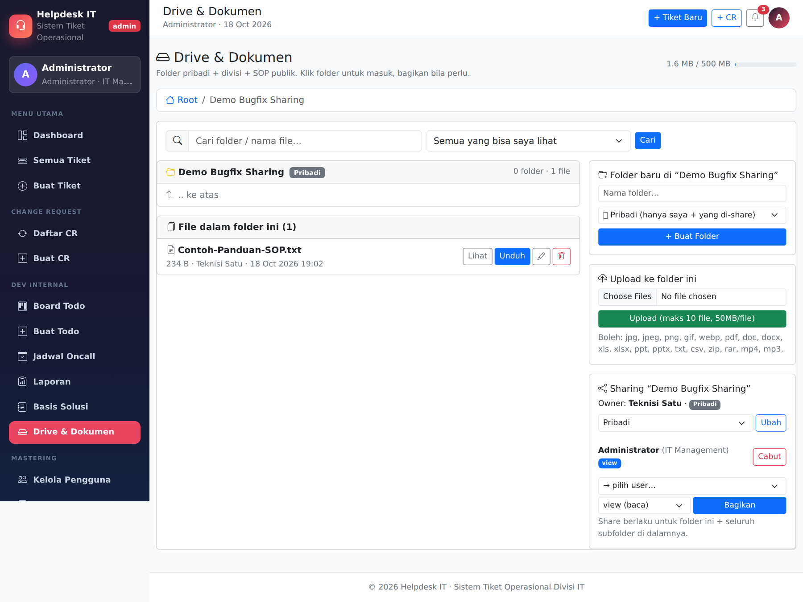

3. Klik tombol hapus → file **berhasil dihapus** oleh penerima `view`.

   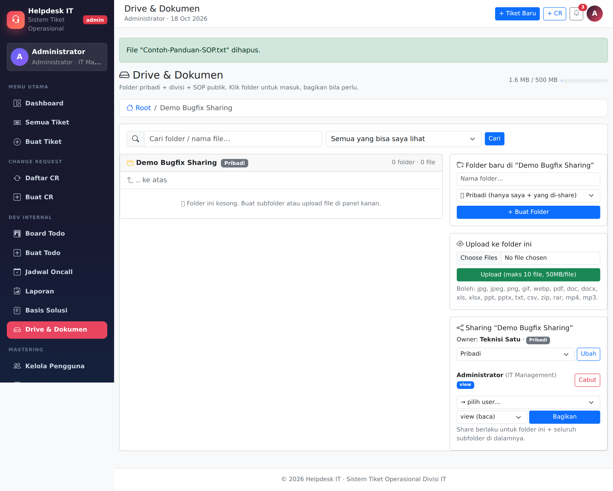

## 7. Verifikasi End-to-End Setelah Perbaikan

### 7.1 Halaman yang terlibat

| # | Halaman | Fungsi |
|---|---|---|
| 1 | `login.php` | Autentikasi semua aktor |
| 2 | `drive.php` (root, owner) | Buat folder |
| 3 | `drive.php` (root, owner) | Folder dibuat + flash sukses |
| 4 | `drive.php?folder=…` (owner) | Upload file + kontrol kelola |
| 5 | `drive.php?folder=…` (owner) | Bagikan `view` + daftar share |
| 6 | `drive.php` (root, penerima) | Root penerima |
| 7 | `drive.php?folder=…` (penerima) | Folder view-only (tanpa tombol kelola) |
| 8 | `drive_action.php` | Percobaan hapus **ditolak** |
| 9 | `drive_download.php?preview=1` | Lihat/unduh tetap boleh untuk `view` |
| 10 | `drive.php?folder=5` | Kasus live "SOP" (admin view-only) |

### 7.2 Galeri halaman (screenshot)

**1. Login** — autentikasi owner (teknisi) dan penerima (admin).

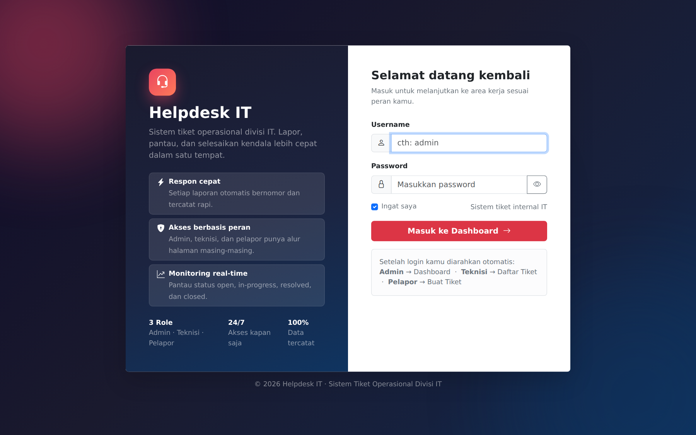

**2. Drive root (owner)** — panel "Folder baru di Root".

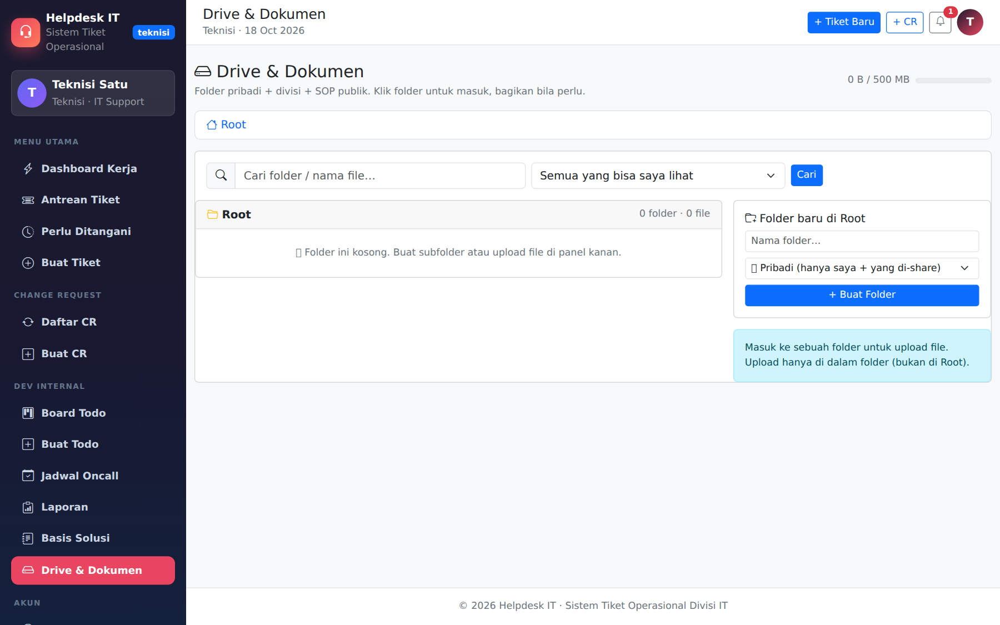

**3. Folder dibuat (owner)** — flash "Folder ... dibuat."

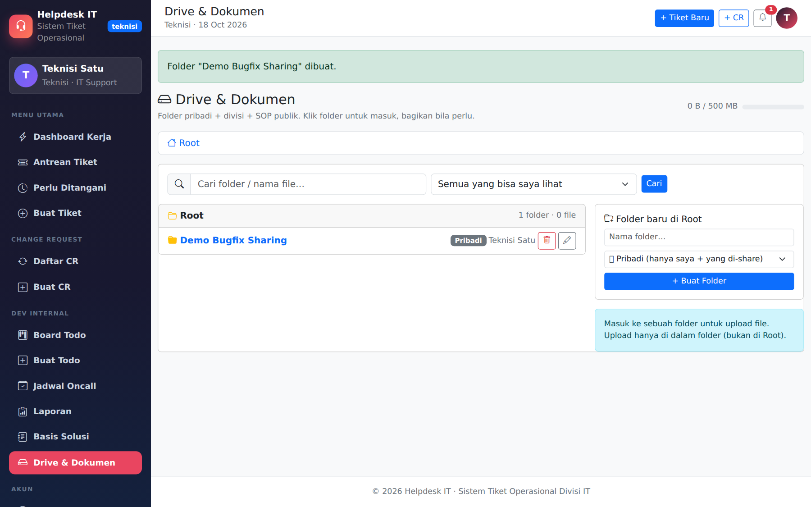

**4. Folder owner + file** — panel upload, tombol Lihat/Unduh, rename & hapus.

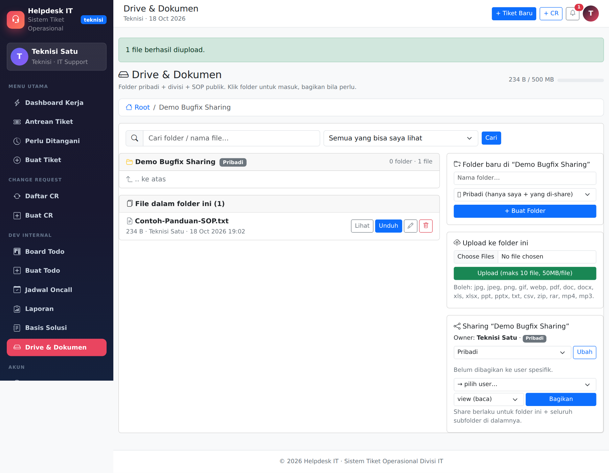

**5. Share view ke admin (owner)** — flash "Folder dibagikan ke Administrator (view)." dan badge `view`.

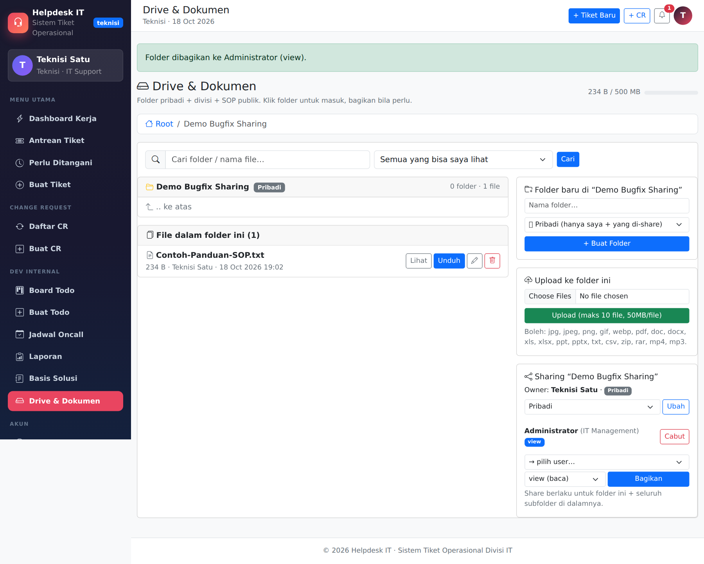

**6. Drive root (penerima)** — folder yang dibagikan tampil di daftar.

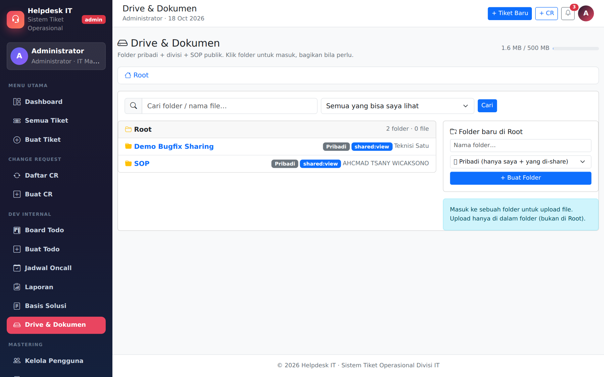

**7. Folder penerima (view-only)** — tanpa tombol hapus/rename/upload; panel share read-only.

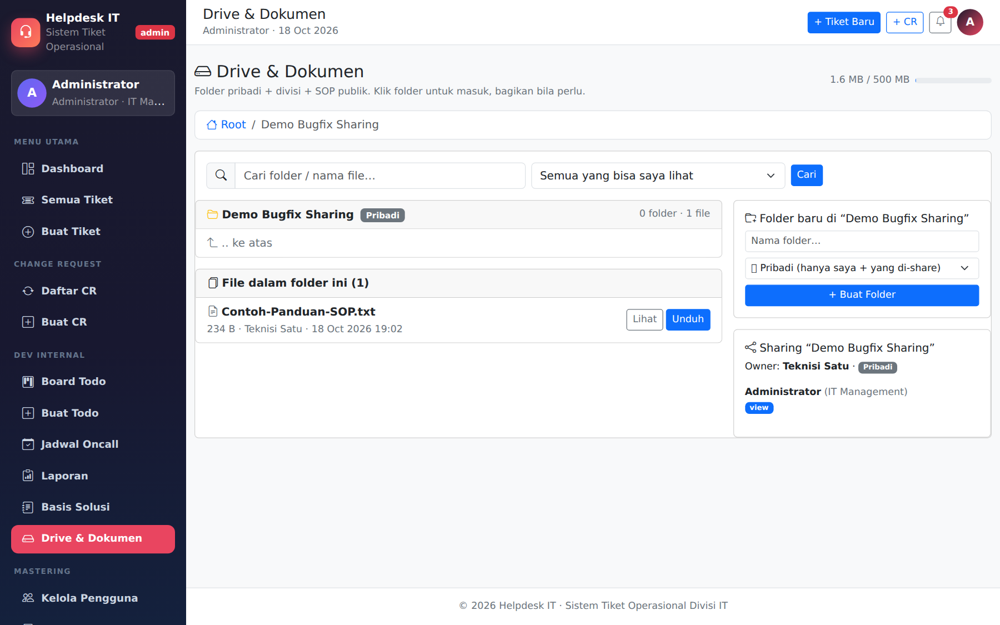

**8. Percobaan hapus ditolak server** — flash "Anda tidak boleh menghapus file ini."

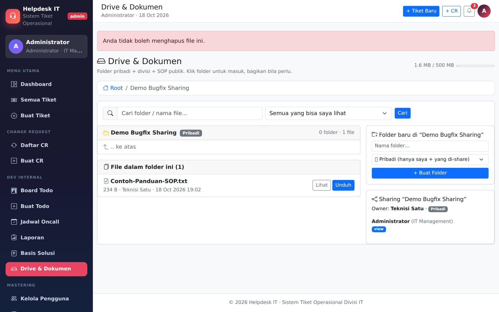

**9. Preview/unduh tetap boleh** — hak `view` = baca.

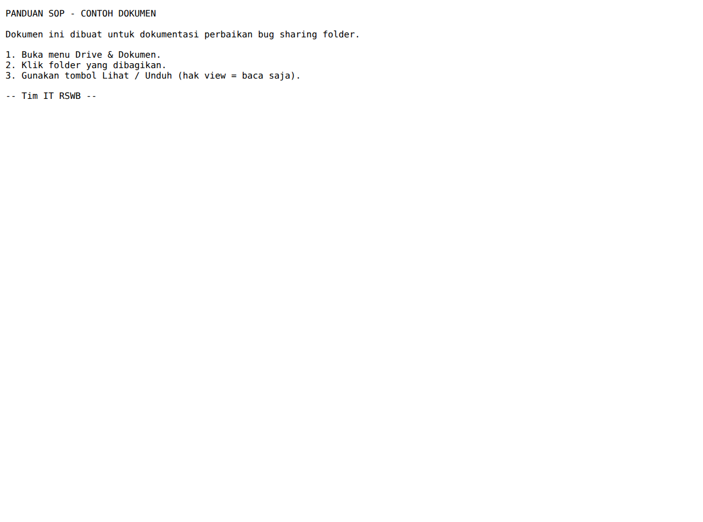

**10. Kasus live folder SOP #5** — Administrator yang di-share `view` hanya bisa baca.

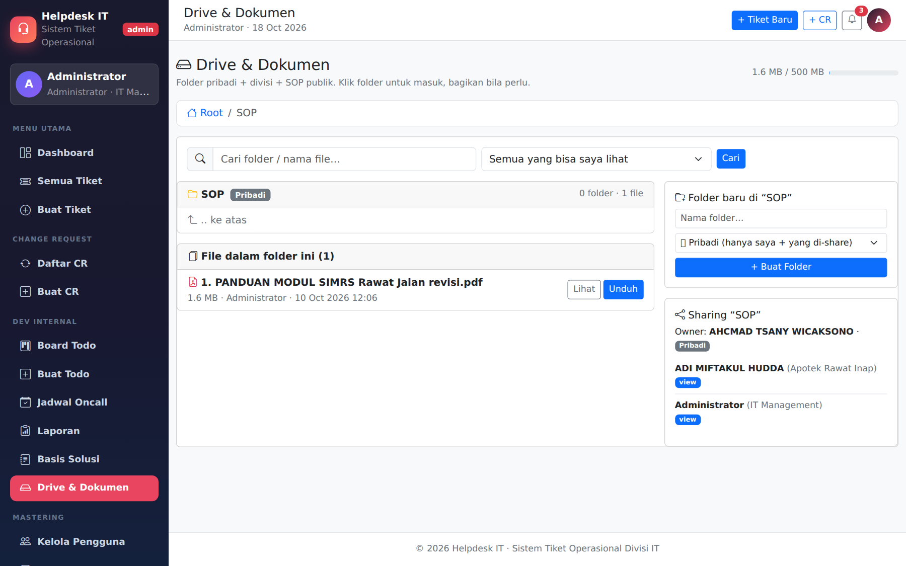

### 7.3 Langkah verifikasi

1. **Bukti bug (kode lama)** — screenshot 11 & 12 di atas: penerima view melihat
   tombol hapus dan berhasil menghapus file.

2. **UI penerima view (kode baru)** — login Administrator, buka folder
   "Demo Bugfix Sharing". Panel upload, tombol rename/hapus, tombol "Ubah",
   "Cabut", dan form "Bagikan" **tidak muncul**; yang tersisa hanya aksi baca
   (Lihat/Unduh) dan badge `view` pada daftar share.

   

3. **Percobaan hapus via POST (bypass UI)** — form dihapus tidak ada, lalu
   dikirim POST `action=file_delete` langsung ke `drive_action.php` dengan CSRF
   valid dari halaman lain. Hasil: server menolak dengan flash
   **"Anda tidak boleh menghapus file ini."** dan file tetap ada.

   

4. **Akses baca tetap jalan** — tombol "Lihat" membuka preview file, "Unduh"
   mengunduh file (hak `view` = baca).

   

5. **Kasus live (folder SOP #5)** — Administrator yang di-share `view` pada
   folder milik user lain hanya melihat aksi baca; tidak ada tombol kelola.

   

6. **Regresi owner/admin tanpa share** — owner (dan admin pada folder tanpa
   share eksplisit) tetap bisa upload, rename, dan menghapus file miliknya.

7. **Pembersihan data uji** — folder "Demo Bugfix Sharing" dihapus oleh owner;
   data produksi kembali seperti semula (`SOP` + share `view`).

   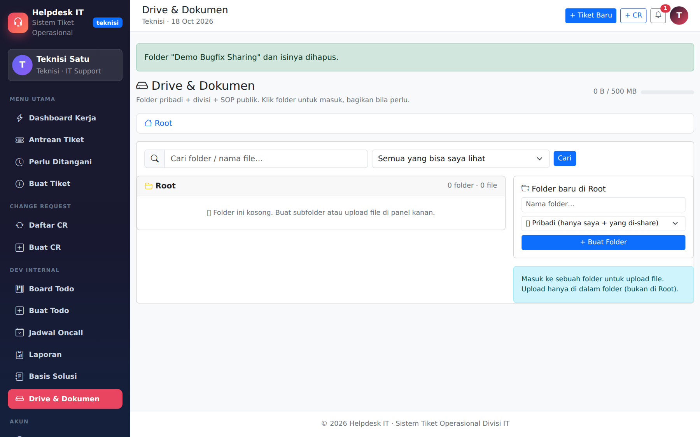

## 8. Matriks Pengujian

Uji fungsi `canViewDrive()` / `canEditDrive()` (harness PHP + PostgreSQL,
transaksi di-rollback):

| # | Skenario | canView | canEdit | Hasil |
|---|---|---|---|---|
| 1 | Share `view` langsung di folder | ✅ true | ❌ false | PASS |
| 2 | Share `edit` di ancestor + `view` langsung di folder | ✅ true | ❌ false | PASS |
| 3 | Share `edit` di ancestor, tanpa share lebih dekat | ✅ true | ✅ true | PASS |
| 4 | Share `view` di ancestor + `edit` langsung di folder | ✅ true | ✅ true | PASS |
| 5 | Share `view` di ancestor, folder anak tanpa share | ✅ true | ❌ false | PASS |
| 6 | Admin tanpa share (folder milik orang lain) | ✅ true | ✅ true | PASS |
| 7 | Admin + share `view` langsung | ✅ true | ❌ false | PASS |
| 8 | Admin + share `view` warisan | ✅ true | ❌ false | PASS |
| 9 | Owner folder | ✅ true | ✅ true | PASS |
| 10 | **Live**: admin + share `view` pada folder "SOP" #5 | ✅ true | ❌ false | PASS |
| 11 | E2E HTTP: POST `file_delete` oleh penerima `view` | — | ditolak + flash error | PASS |
| 12 | E2E HTTP: owner/admin tanpa share hapus file sendiri | — | berhasil | PASS |

## 9. Catatan Teknis

- **Kenapa `array_position`?** Rantai ancestor dibangun dari root → folder
  (`getDriveAncestors()`), sehingga posisi terbesar = share terdekat.
  `ORDER BY array_position(ARRAY[...]::int[], folder_id) DESC LIMIT 1`
  memilih share paling spesifik dalam satu query (tetap 1 query per cek,
  placeholder `$2…$n` yang sama dengan klausa `IN`).
- **Kebijakan admin.** Admin tetap superuser default (bisa mengelola folder
  yang tidak di-share eksplisit ke dirinya), tetapi share `view` eksplisit kini
  mengikat semua penerima — konsisten dengan label UI `view (baca)` dan
  menghilangkan celah yang dilaporkan.
- **UI otomatis konsisten** karena `drive.php` memakai `canEditDrive()` yang
  sama untuk menampilkan/menyembunyikan tombol kelola.
- **Data uji** (folder demo, file `Contoh-Panduan-SOP.txt`) sudah dihapus
  setelah verifikasi; tidak ada perubahan data produksi.

## 10. Cara Menguji Ulang

1. Siapkan dua akun (pemilik dan penerima).
2. Sebagai pemilik: buat folder, upload file, buka panel **Sharing**, pilih
   penerima + permission `view (baca)`, klik **Bagikan**.
3. Sebagai penerima: buka folder tersebut — pastikan tidak ada tombol
   upload/rename/hapus/kelola share.
4. (Opsional, bypass UI) Kirim POST langsung:

   ```bash
   curl -s -b cookies.txt -c cookies.txt \
     --data-urlencode "csrf_token=<TOKEN>" \
     --data "action=file_delete&file_id=<ID>" \
     http://localhost/helpdesk/drive_action.php -o /dev/null -w "%{http_code}\n"
   ```

   Harapan: redirect (302) + flash `Anda tidak boleh menghapus file ini.`,
   file tetap ada di folder dan di `uploads/drive/`.
5. Regresi: sebagai penerima yang sama, berikan share `edit` — tombol hapus
   muncul dan operasi berhasil.
